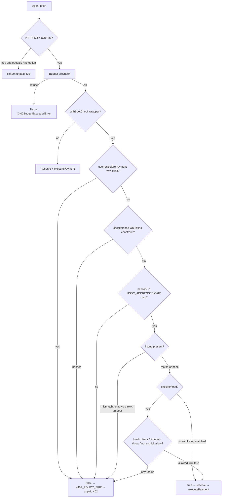

# Fail-closed x402 payment spot check - Plan

## Goal Capsule

**Objective:** An agent using this SDK can attach a pre-pay spot check so a 402 payment is refused whenever that check is missing, unreachable, times out, errors, or rejects the terms.

**Means:** A vendored `withSpotCheck` config wrapper that composes `onBeforePayment` and declines via the existing unpaid-402 policy skip (KTD1, KTD2).

**Authority:** Product Contract Key Decisions and R-IDs own behavior. Planning Contract KTDs own mechanism. Units cite, they do not restate.

**Stop if:** The change would add a `github:` or fail-open dependency, edit `.github/workflows/**`, bump the package version, or reuse PR #91 / #96 branches.

**Who finishes:** `ce-work` implements on a fresh branch in `up2itnow0822/agent-wallet-sdk`. Shipping opens one ready-for-review PR that supersedes #91 and #96. Do not merge.

---

## Product Contract

### Summary

Add an in-SDK x402 pre-pay spot check that agents opt into by wrapping client config. When the wrapper is used, payment proceeds only after an explicit allow. Missing checker, listing miss, throw, timeout, or reject all refuse the payment. Unconfigured clients keep today's pay path. The published `x402-spotcheck` package is not used.

### Problem Frame

Open PR #91 added opt-in `withSpotCheck` that proceeds when the optional peer is missing, times out, or throws. Draft PR #96 flipped that wrapper to fail-closed and dropped the git/npm dependency, but it still lives on a reused #91 lineage and patches `X402Client` for after-pay. Operators need one fresh PR from this repo that refuses unsafe 402s without a fork dependency or a fail-open default.

### Key Decisions

- Fail closed on missing, unreachable, timeout, error, or reject. (session-settled: user-directed — chosen over fail-open / an opt-out flag that defaults to open: #91 proceeds on those faults.) Governs R1, R2, R3, R4, R5, R10.
- No git dependency on a fork. (session-settled: user-directed — chosen over `github:withgrokbot/x402-spotcheck` or any `github:` pin: supply-chain risk named in #96.) Governs R6.
- Required tests: pass, reject, missing check, check error/throw, timeout. Refuse cases prove no transfer; pass proves one transfer. (session-settled: user-directed — chosen over incomplete or fail-open coverage.) Governs R7.
- README and peer-dependency lists stay consistent with `main`. (session-settled: user-directed — chosen over #91's optional-peer install story.) Governs R8, R9.
- Wrapper is opt-in; unconfigured clients are unchanged. (inferred headless default — chosen over always-on fail-closed: always-on would refuse every current `createX402Fetch(wallet)` call and force a major version, which this request forbids.) Governs R11.

### Requirements

- R1. When the wrapper is used, a payment is refused if no checker/load is supplied and no listing constraint is present.
- R2. When the wrapper is used, a payment is refused if the checker, loader, or `expected` listing function throws.
- R3. When the wrapper is used, a payment is refused if load, `expected`, and `checkBeforePay` together exceed one `timeoutMs` budget (default 2000).
- R4. When the wrapper is used, a payment is refused if the checker returns a non-allow (`allowed !== true` or `verdict: skip`) or a listing mismatches payTo, network, or price.
- R5. When the wrapper is used, a payment proceeds only when the check explicitly allows (listing match and/or `allowed === true`).
- R6. Shipped source must not import `x402-spotcheck` or any `github:` package.
- R7. Tests cover pass, reject, missing check, throw, and timeout, each asserting `executePayment` is never called on refuse.
- R8. `package.json` peerDependencies and peerDependenciesMeta stay identical to `main`.
- R9. README may describe the wrapper; it must not add a new peer install or GitHub-install command.
- R10. The wrapper must not expose a flag that defaults to skipping the check or proceeding on fault (`failOpen`, `prePay: false`, or equivalent).
- R11. Clients built without the wrapper keep current auto-pay behavior.
- R12. A caller `onBeforePayment` that returns `false` still declines before the spot check runs.
- R13. A refused spot check must not look like a settled, queued, or unknown settlement.
- R16. When the wrapper is used, a payment is refused if the selected network is not in the `USDC_ADDRESSES` CAIP map.
- R14. Public exports of the wrapper and its types appear on both `src/x402/index.ts` and `src/index.ts`.
- R15. Do not edit `.github/workflows/**`, bump the package version, publish, tag, or reuse the #91 / #96 branches.

### Actors

- A1. Paying agent — calls `createX402Fetch`, `X402Client.fetch`, or `wrapWithX402`.
- A2. Merchant — returns HTTP 402 with selected terms.
- A3. Optional caller checker — `checkBeforePay` used only when supplied.

### Key Flows

- F1. Allow. Agent fetch → 402 → budget precheck → user hook not false → listing and/or checker explicitly allow → reserve → `executePayment` → paid retry.
- F2. Refuse. Same path through the wrapper; any of R1–R4 or R16 fails → `onBeforePayment` returns false → unpaid 402, no reserve, no transfer.
- F3. Unconfigured. No wrapper → existing `onBeforePayment` / auto-pay path (R11).

### Acceptance Examples

- AE1. Covers R5, F1. Listing `{ payTo, network, price }` matches the selected requirement → payment proceeds.
- AE2. Covers R4, F2. Listing payTo differs from the selected requirement → unpaid 402, `executePayment` not called.
- AE3. Covers R1, F2. `withSpotCheck(config)` with empty opts → unpaid 402, `executePayment` not called.
- AE4. Covers R2, F2. Supplied `load` / `checkBeforePay` / `expected` throws → unpaid 402, `executePayment` not called.
- AE5. Covers R3, F2. Awaited check exceeds 2000 ms → unpaid 402, `executePayment` not called.

### Success Criteria

- The five required refuse/allow cases are proven against a real `X402Client` fetch with a stubbed wallet, not a standalone helper isolated from `onBeforePayment`.
- `test/package-peers.test.ts` still matches `main`'s peer set.
- README still documents only the existing optional peers (Solana, Stellar).

### Scope Boundaries

In scope: vendored pre-pay wrapper, tests, root/submodule exports, a brief README mention.

Out of scope / deferred follow-up: after-pay, `X402Client.prototype` watches, `x402FromEnv` / Eliza auto-composition, Stellar/Solana network maps, service-mode HTTP probes, version publish, workflow edits, merging or closing #91/#96.

### Assumptions

- Opt-in wrapper (Key Decision 5) is the headless resolution of "no opt-out flag that defaults to open": the forbidden flag is a skip/fail-open switch on the wrapper, not the existence of unconfigured clients.
- Listing plus checker is AND.
- Listing `price` is USDC atomic units and must equal `selected.amount` exactly (string or bigint, no float, no 1% slack). Callers with dollar catalog values convert (`usd * 1e6`) before passing `price`.
- A resolved listing allows only when it contains at least one of `payTo`, `network`, or `price` and every supplied field matches. `expected` returning `undefined`, `null`, or `{}` refuses.
- One overall timeout budget of 2000 ms covers load, `expected`, and `checkBeforePay` together.
- Decline uses the existing unpaid-402 skip, not a new thrown type (R13). There is no `onDecision` API in this PR.
- Slack organizational search was available and not requested.

---

## Planning Contract

### Key Technical Decisions

- KTD1. Vendor listing and checker-dispatch logic in `src/x402/spotcheck.ts` with the repo's MIT `@module` header (and any copied rules' license header). (session-settled: user-directed — chosen over adding `x402-spotcheck` as a git or npm dependency: published `x402-spotcheck@1.6.1` is fail-open by design — "unknown / timeout / error means pay" — so it is not a suitable package under the user's vendor-if-unsuitable rule.) Cites R6, R8.
- KTD2. Implement as a non-mutating `withSpotCheck(config, opts)` that replaces `onBeforePayment`. Do not edit `authorizeFreshTransfer` or always-on client internals. Cites R11, R12.
- KTD3. Map every `USDC_ADDRESSES` key (`name:id`, including `base-sepolia:84532`) to `eip155:<id>` and accept that CAIP form. Normalize both the selected requirement network and the listing network through this map before compare. Unrecognized networks refuse (R16). Bake-off was not run: npm-vs-vendor was already decidable from the published package's fail-open contract.
- KTD4. After-pay and prototype patching stay out. #96's `installAfterPayWatch` mutates `X402Client.prototype`.
- KTD5. Tests spy `executePayment` (or equivalent) on a constructed client using the wrapper, following `src/x402/__tests__/client.test.ts`. Cites R7, R13.

### High-Level Technical Design

The wrapper never calls `executePayment`. It only returns a boolean to the existing gate in `src/x402/client.ts`.

### Implementation Constraints

- Runtime-neutral: no `Buffer`, no Node-only globals.
- No lazy `import('x402-spotcheck')` — `test/package-peers.test.ts` would then require a peer or dependency.
- Do not read `.env` / secrets. Do not force-push.

### Sequencing

U1 tests first (red), U2 implementation (green), U3 exports and README.

### System-Wide Impact

`createX402Fetch`, `wrapWithX402`, and `X402Client` take the wrapper only when the caller passes the returned config. `x402FromEnv` and Eliza helpers stay on today's path (R11). A refuse is an unpaid HTTP 402 with no reservation, the same signal as a merchant 402 or a recipient-allowlist skip (R13). Tests spy `executePayment` so a refuse cannot be mistaken for a debit. Concurrent same-intent retries still single-flight in `X402Client`; the wrapper is a boolean gate and does not add a second transfer path.

### Risks & Dependencies

- Checker or listing outage refuses every wrapped payment. That is the intended fail-closed behavior, not a defect. Mitigation: callers who need availability keep a live checker or listing, or do not attach the wrapper.
- Silent unpaid 402 can look like "merchant still unpaid." Mitigation: README states the wrapper is fail-closed; tests spy `executePayment` so a refuse cannot be mistaken for a debit. This PR does not add a thrown refuse type (R13).
- Copying #96 after-pay would mutate `X402Client.prototype` for every client. Mitigation: KTD4.

---

## Implementation Units

### U1. Fail-closed spot-check contract tests

**Goal:** Lock the required pass/refuse matrix against `X402Client` before the wrapper exists.

**Requirements:** R1, R2, R3, R4, R5, R7, R10, R12, R13, R16. Cites KTD5.

**Dependencies:** none.

**Files:** `src/x402/__tests__/spotcheck.test.ts` (create). May import helpers from `src/x402/__tests__/client.test.ts` / `receipt-evidence.ts` patterns.

**Approach:**

1. Build a client the same way existing x402 fetch tests do (stub wallet, stub `executePayment`, 402 then 200).
2. Pass `withSpotCheck(...)` as the client config.
3. Write the five required cases plus user-hook-first and unrecognized-network refuses.
4. On refuse, assert the fetch result is unpaid 402 and `executePayment` was not called.
5. On pass, assert `executePayment` is called once.

**Execution note:** Implement new domain behavior test-first. These tests should fail to compile or fail at runtime until U2 lands.

**Patterns to follow:** `src/x402/__tests__/client.test.ts` (onBeforePayment skip and execute spies), `src/x402/__tests__/funds-safety.test.ts` (policy false → no pay).

**Test scenarios:**

- Pass: listing `payTo` / `network: "base:8453"` / atomic `price` matching `amount` on selected `base:8453` USDC terms → `executePayment` called once.
- Pass testnet: listed `base-sepolia:84532` requirement allows when listing matches.
- Reject payTo: listing payTo differs → unpaid 402, `executePayment` not called.
- Reject price: listing price differs from `selected.amount`, including a ~1.01× amount #96 slack would accept → unpaid 402, `executePayment` not called.
- Reject network: listing names a different mapped chain than the selected requirement → unpaid 402, `executePayment` not called.
- Reject AND: listing payTo mismatches while `checkBeforePay` returns `{ allowed: true }` → unpaid 402, `executePayment` not called.
- Missing check: `withSpotCheck({})` with no checker and no listing fields → unpaid 402, `executePayment` not called.
- Empty expected: `expected` returns `undefined` or `{}` → unpaid 402, `executePayment` not called.
- Check throw: `load`, `checkBeforePay`, or `expected` throws → unpaid 402, `executePayment` not called.
- Timeout: load + expected + checkBeforePay together exceed one `timeoutMs` budget (default 2000, or a lower injected value) → unpaid 402, `executePayment` not called.
- User hook first: inner `onBeforePayment` returns false → checker is not invoked, unpaid 402.
- Unrecognized network: selected `ethereum:1` mapped correctly must pass listing when listed; a junk network string refuses (R16).
- No fail-open API: wrapper options type has no `failOpen` / `prePay` skip default (compile-time or runtime absence).

**Verification:** The new test file exists and names all required cases. Until U2, `npm test` fails on the missing module or failed assertions.

### U2. Vendored fail-closed `withSpotCheck`

**Goal:** Ship the wrapper that makes U1 pass.

**Requirements:** R1–R6, R10, R12, R13, R16. Cites KTD1, KTD2, KTD3, KTD4.

**Dependencies:** U1.

**Files:** `src/x402/spotcheck.ts` (create).

**Approach:**

1. Export `withSpotCheck` and the small option/decision types U1 imports.
2. Compose the caller's `onBeforePayment`; return false immediately on `=== false`.
3. Treat listing constraint as `expected` function, nonempty `payTo` / `network`, or non-null `price`. A resolved listing allows only when it has at least one of those fields and every supplied field matches. `expected` returning `undefined`, `null`, or `{}` refuses.
4. Convert selected and listing networks via KTD3; refuse unrecognized (R16). Compare `price` to `selected.amount` as exact atomic units.
5. Wrap load / expected / checkBeforePay in one shared timeout budget; catch → false.
6. Require `allowed === true` (and not `skip`) when a checker is present.
7. Keep after-pay out. Do not patch `X402Client`.
8. Keep the MIT `@module` header used by `src/x402/*.ts`. If any rule text is copied from `x402-spotcheck` / `spotcheck-rules`, keep that MIT header too.

**Patterns to follow:** `src/x402/types.ts` module header; boolean `onBeforePayment` in `src/convenience.ts`; no prototype mutation.

**Test scenarios:** Covered by U1. Add only a unit-local case if implementation introduces a helper that U1 cannot see (for example CAIP conversion of `base:8453` → `eip155:8453` used in listing compare).

**Verification:** `src/x402/__tests__/spotcheck.test.ts` passes. No new dependency or peer. No `import('x402-spotcheck')`.

### U3. Public exports and README

**Goal:** Make the wrapper part of the published API without changing peers or install docs.

**Requirements:** R8, R9, R14, R15.

**Dependencies:** U2.

**Files:** `src/x402/index.ts`, `src/index.ts`, `README.md`.

**Approach:**

1. Re-export `withSpotCheck` and its types from the x402 barrel and the package root so `test/root-exports.test.ts` stays green.
2. Add a short README note that the wrapper is opt-in and fail-closed when used. Do not add a peer or GitHub install line. Leave Solana/Stellar peer sections unchanged.
3. Do not edit `.github/workflows/**` or `package.json` version / peerDependencies.

**Test expectation:** none for README. Export consistency is enforced by existing `test/root-exports.test.ts` and `test/package-peers.test.ts`.

**Verification:** Root export test passes. `package.json` peers match `main`. README still lists only Solana and Stellar as optional peers.

---

## Verification Contract

Repo gates from `AGENTS.md`:

- `npm run build`
- `npm test` (includes `src/x402/__tests__/spotcheck.test.ts` plus `test/root-exports.test.ts` and `test/package-peers.test.ts`)
- `npm run lint` after source edits
- `npx tsc --noEmit` if a type-only miss is suspected

Do not publish, tag, or bump version.

---

## Definition of Done

- U1–U3 landed on a fresh branch created from current `origin/main` in `up2itnow0822/agent-wallet-sdk` (not `feat/x402-spotcheck-hook`, not `cloud/x402-spotcheck-fix-91`).
- R1–R15 hold. Local build, test, and lint are green.
- Abandoned experiment files (copied #91/#96 after-pay, npm import stubs) are removed from the diff.
- One open, non-draft PR from that branch. Body states it supersedes #91 and #96, summarizes fail-closed design, lists the five tests. Request review from nobody. Do not merge.

---

## Sources & Research

- PRs: https://github.com/up2itnow0822/agent-wallet-sdk/pull/91 (fail-open optional peer), https://github.com/up2itnow0822/agent-wallet-sdk/pull/96 (fail-closed draft, git dep removed).
- Gate: `src/x402/client.ts` `authorizeFreshTransfer` / `X402_POLICY_SKIP`.
- Config: `src/x402/types.ts` `onBeforePayment`, `DEFAULT_SUPPORTED_NETWORKS`.
- Peers: `package.json`, `test/package-peers.test.ts`.
- Local contracts: `AGENTS.md`, `src/AGENTS.md`.
- npm `x402-spotcheck@1.6.1` README: fail-open contract ("timeout or an error lets the payment through"; semver never turns pay into skip). Not used.
- No `docs/solutions/` learnings. No Compound Packs.
