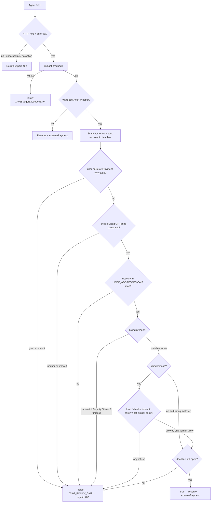

# Fail-closed x402 payment spot check - Plan

## Goal Capsule

**Objective:** An agent using this SDK can attach a pre-pay spot check so a 402 payment is refused whenever that check is missing, unreachable, times out, errors, or rejects the terms, including when a caller hook or checker hangs or returns allow after the budget.

**Means:** A vendored `withSpotCheck` config wrapper that composes `onBeforePayment`, declines via the existing unpaid-402 policy skip, and runs the caller hook plus the whole spot check under one monotonic deadline (KTD1, KTD2, KTD6).

**Authority:** Product Contract Key Decisions and R-IDs own behavior. Planning Contract KTDs own mechanism. Units cite, they do not restate.

**Stop if:** The change would add a `github:` or fail-open dependency, edit `.github/workflows/**`, bump the package version, reuse PR #91 / #96 / #103 branches, or push to `cloud/x402-fail-closed-spotcheck-77bf`.

**Who finishes:** `ce-work` implements on a fresh branch created from PR #103 head `b3a3873d` in `up2itnow0822/agent-wallet-sdk`. Shipping opens one ready-for-review PR into `main` that supersedes #103 (and #91 / #96). Do not merge. Do not push to #103's branch.

**Product Contract preservation:** changed: R3 — one budget now covers the caller hook and the whole spot check, including accept-time recheck; R5 — allow requires `verdict === 'allow'`; added R17–R22.

---

## Product Contract

### Summary

Add an in-SDK x402 pre-pay spot check that agents opt into by wrapping client config. When the wrapper is used, payment proceeds only after an explicit allow. Missing checker, listing miss, throw, timeout, hang, late allow, or reject all refuse the payment. Unconfigured clients keep today's pay path. The published `x402-spotcheck` package is not used.

### Problem Frame

Open PR #91 added opt-in `withSpotCheck` that proceeds when the optional peer is missing, times out, or throws. Draft PR #96 flipped that wrapper to fail-closed and dropped the git/npm dependency, but it still lives on a reused #91 lineage and patches `X402Client` for after-pay. Draft PR #103 vendored fail-closed pre-pay in this repo and fixed explicit-allow, terms snapshot, timeout validation, and static+`expected()` AND. Its remaining deadline is split: the caller hook is awaited outside the budget, `Date.now()` is the clock, a late allow after a blocked event loop still authorizes, and `timeoutMs` above `2^31-1` can fire after 1 ms. Operators need one fresh PR that keeps #103's fail-closed allow logic and redesigns the deadline as one monotonic wrapper.

### Key Decisions

- Fail closed on missing, unreachable, timeout, error, or reject. (session-settled: user-directed — chosen over fail-open / an opt-out flag that defaults to open: #91 proceeds on those faults.) Governs R1, R2, R3, R4, R5, R10, R17, R18, R19, R20.
- No git dependency on a fork. (session-settled: user-directed — chosen over `github:withgrokbot/x402-spotcheck` or any `github:` pin: supply-chain risk named in #96.) Governs R6.
- Required tests: pass, reject, missing check, check error/throw, timeout, hanging hook, late allow, event-loop-blocked late allow, and a timeout-fires proof. Refuse cases prove no transfer; pass proves one transfer. (session-settled: user-directed — chosen over incomplete or fail-open coverage.) Governs R7, R21.
- README and peer-dependency lists stay consistent with `main`. (session-settled: user-directed — chosen over #91's optional-peer install story.) Governs R8, R9.
- Wrapper is opt-in; unconfigured clients are unchanged. (inferred headless default — chosen over always-on fail-closed: always-on would refuse every current `createX402Fetch(wallet)` call and force a major version, which this request forbids.) Governs R11.
- One deadline covers the caller hook and the whole spot check. (session-settled: user-directed — chosen over a Date-based or split hook/check timeout: #103 hangs on a never-returning hook and accepts a late allow after a blocked loop.) Governs R3, R17, R18, R19, R20, R22.

### Requirements

- R1. When the wrapper is used, a payment is refused if no checker/load is supplied and no listing constraint is present.
- R2. When the wrapper is used, a payment is refused if the checker, loader, or `expected` listing function throws.
- R3. When the wrapper is used, a payment is refused if the caller `onBeforePayment` hook and the spot check (`expected()`, loader, checker, listing-only path) together exceed one `timeoutMs` budget (default 2000).
- R4. When the wrapper is used, a payment is refused if the checker returns a non-allow (`allowed !== true` or `verdict !== 'allow'`) or a listing mismatches payTo, network, or price.
- R5. When the wrapper is used, a payment proceeds only when the check explicitly allows: listing match and/or `allowed === true && verdict === 'allow'`, and only if the deadline has not passed at the moment that decision is accepted.
- R6. Shipped source must not import `x402-spotcheck` or any `github:` package.
- R7. Tests cover pass, reject, missing check, throw, timeout, hanging hook, late allow, and event-loop-blocked late allow, each asserting `executePayment` is never called on refuse.
- R8. `package.json` peerDependencies and peerDependenciesMeta stay identical to `main`.
- R9. README may describe the wrapper; it must not add a new peer install or GitHub-install command.
- R10. The wrapper must not expose a flag that defaults to skipping the check or proceeding on fault (`failOpen`, `prePay: false`, or equivalent).
- R11. Clients built without the wrapper keep current auto-pay behavior.
- R12. A caller `onBeforePayment` that returns `false` still declines before the spot check runs.
- R13. A refused spot check must not look like a settled, queued, or unknown settlement.
- R16. When the wrapper is used, a payment is refused if the selected network is not in the `USDC_ADDRESSES` CAIP map.
- R14. Public exports of the wrapper and its types appear on both `src/x402/index.ts` and `src/index.ts`.
- R15. Do not edit `.github/workflows/**`, bump the package version, publish, tag, or reuse the #91 / #96 / #103 branches.
- R17. The shared deadline uses a monotonic clock (`performance.now()`, or an injected clock), never `Date`.
- R18. `timeoutMs` must be finite and greater than 0, and must not exceed 60_000. Values above `2^31-1` are rejected at wrap time so a timer cannot fire after 1 ms.
- R19. At the moment a decision is accepted, re-check the deadline. If it has passed, refuse, even when the result is an explicit allow.
- R20. A caller hook or check that never returns must not hang the request: the deadline fires and the payment is refused.
- R21. Static listing `network` or `price` that conflicts with `expected()` refuses (same AND rule as payTo).
- R22. If `checkBeforePay` already receives an options record, pass an `AbortSignal` that aborts when the shared deadline fires. Do not add a large new checker contract for this.

### Actors

- A1. Paying agent — calls `createX402Fetch`, `X402Client.fetch`, or `wrapWithX402`.
- A2. Merchant — returns HTTP 402 with selected terms.
- A3. Optional caller checker — `checkBeforePay` used only when supplied.

### Key Flows

- F1. Allow. Agent fetch → 402 → budget precheck → unified deadline starts → user hook not false → listing and/or checker explicitly allow → deadline still open at accept → reserve → `executePayment` → paid retry.
- F2. Refuse. Same path through the wrapper; any of R1–R4, R16–R21 fails → `onBeforePayment` returns false → unpaid 402, no reserve, no transfer.
- F3. Unconfigured. No wrapper → existing `onBeforePayment` / auto-pay path (R11).

### Acceptance Examples

- AE1. Covers R5, F1. Listing `{ payTo, network, price }` matches the selected requirement → payment proceeds.
- AE2. Covers R4, F2. Listing payTo differs from the selected requirement → unpaid 402, `executePayment` not called.
- AE3. Covers R1, F2. `withSpotCheck(config)` with empty opts → unpaid 402, `executePayment` not called.
- AE4. Covers R2, F2. Supplied `load` / `checkBeforePay` / `expected` throws → unpaid 402, `executePayment` not called.
- AE5. Covers R3, R20, F2. Awaited check or hanging hook exceeds the budget → unpaid 402, `executePayment` not called.
- AE6. Covers R19, F2. Checker returns `{ allowed: true, verdict: 'allow' }` after the deadline, including after a blocked event loop → unpaid 402, `executePayment` not called.
- AE7. Covers R21, F2. Static `network` or `price` conflicts with `expected()` → unpaid 402, `executePayment` not called.

### Success Criteria

- The required refuse/allow cases are proven against a real `X402Client` fetch with a stubbed wallet, not a standalone helper isolated from `onBeforePayment`.
- Deadline tests use a fake or injected clock. A hanging hook refuses at the deadline. A late allow refuses. An event-loop-blocked late allow refuses. At least one test fails if the timeout logic is removed.
- `test/package-peers.test.ts` still matches `main`'s peer set.
- README still documents only the existing optional peers (Solana, Stellar).

### Scope Boundaries

In scope: vendored pre-pay wrapper, unified monotonic deadline, tests, root/submodule exports, a brief README mention.

Out of scope / deferred follow-up: after-pay, `X402Client.prototype` watches, `x402FromEnv` / Eliza auto-composition, Stellar/Solana network maps, service-mode HTTP probes, version publish, workflow edits, merging or closing #91/#96/#103, pushing to #103's branch.

### Assumptions

- Opt-in wrapper (Key Decision 5) is the headless resolution of "no opt-out flag that defaults to open": the forbidden flag is a skip/fail-open switch on the wrapper, not the existence of unconfigured clients.
- Listing plus checker is AND.
- Listing `price` is USDC atomic units and must equal `selected.amount` exactly (string or bigint, no float, no 1% slack). Callers with dollar catalog values convert (`usd * 1e6`) before passing `price`.
- A resolved listing allows only when it contains at least one of `payTo`, `network`, or `price` and every supplied field matches. `expected` returning `undefined`, `null`, or `{}` refuses.
- One overall timeout budget of 2000 ms covers the caller hook, load, `expected`, and `checkBeforePay` together.
- `timeoutMs` above 60_000 is rejected at wrap time (same class as non-finite or `<= 0`), not silently clamped. 60_000 is accepted.
- Decline uses the existing unpaid-402 skip, not a new thrown type (R13). There is no `onDecision` API in this PR.
- Default clock is `performance.now()` (runtime-neutral). `process.hrtime.bigint()` is not used in shipped code. Tests inject a clock.
- Optional injected `clock` on options is a test seam, not a fail-open flag.
- AbortSignal is passed as `signal` on the existing `checkBeforePay` options record (R22).
- Slack organizational search was available and not requested.

---

## Planning Contract

### Key Technical Decisions

- KTD1. Vendor listing and checker-dispatch logic in `src/x402/spotcheck.ts` with the repo's MIT `@module` header (and any copied rules' license header). (session-settled: user-directed — chosen over adding `x402-spotcheck` as a git or npm dependency: published `x402-spotcheck@1.6.1` is fail-open by design — "unknown / timeout / error means pay" — so it is not a suitable package under the user's vendor-if-unsuitable rule.) Cites R6, R8.
- KTD2. Implement as a non-mutating `withSpotCheck(config, opts)` that replaces `onBeforePayment`. Do not edit `authorizeFreshTransfer` or always-on client internals. Cites R11, R12.
- KTD3. Map every `USDC_ADDRESSES` key (`name:id`, including `base-sepolia:84532`) to `eip155:<id>` and accept that CAIP form. Normalize both the selected requirement network and the listing network through this map before compare. Unrecognized networks refuse (R16). Bake-off was not run: npm-vs-vendor was already decidable from the published package's fail-open contract.
- KTD4. After-pay and prototype patching stay out. #96's `installAfterPayWatch` mutates `X402Client.prototype`.
- KTD5. Tests spy `executePayment` (or equivalent) on a constructed client using the wrapper, following `src/x402/__tests__/client.test.ts`. Cites R7, R13.
- KTD6. One deadline wrapper covers the caller hook and the whole spot check under a single budget. Clock is monotonic and injectable. Accept-time recheck refuses a late allow. `timeoutMs` max is 60_000. (session-settled: user-directed — chosen over Date.now(), split hook/check timers, or an uncapped timeout: #103 SO N1 overflow, hanging hook, and late-allow after a blocked loop.) Cites R3, R17, R18, R19, R20, R22.
- KTD7. Keep #103 fail-closed allow logic: `allowed === true && verdict === 'allow'`; snapshot terms before the caller hook and check the snapshot; validate `timeoutMs`; enforce static constraints alongside `expected()`. (session-settled: user-directed — chosen over reopening those gates: they are already correct on `b3a3873d`.) Cites R4, R5, R12, R18, R21.

### High-Level Technical Design

The wrapper never calls `executePayment`. It only returns a boolean to the existing gate in `src/x402/client.ts`. One wrapper times the hook, `expected()`, loader, checker, and listing-only path together. A timer abort and an accept-time `now() >= deadline` check are both refuse paths.

### Implementation Constraints

- Runtime-neutral: no `Buffer`, no Node-only globals, no `process.hrtime` in shipped code.
- No lazy `import('x402-spotcheck')` — `test/package-peers.test.ts` would then require a peer or dependency.
- No new dependencies.
- Do not read `.env` / secrets. Do not force-push. Do not push `cloud/x402-fail-closed-spotcheck-77bf`.

### Sequencing

U1–U3 already landed on #103 (`b3a3873d`). U4 redesigns the deadline and adds the clock-injected tests.

### System-Wide Impact

`createX402Fetch`, `wrapWithX402`, and `X402Client` take the wrapper only when the caller passes the returned config. `x402FromEnv` and Eliza helpers stay on today's path (R11). A refuse is an unpaid HTTP 402 with no reservation, the same signal as a merchant 402 or a recipient-allowlist skip (R13). Tests spy `executePayment` so a refuse cannot be mistaken for a debit. Concurrent same-intent retries still single-flight in `X402Client`; the wrapper is a boolean gate and does not add a second transfer path. A hanging hook no longer holds the in-flight settlement slot past `timeoutMs`.

### Risks & Dependencies

- Checker, listing, or caller-hook outage / hang refuses every wrapped payment. That is the intended fail-closed behavior, not a defect. Mitigation: callers who need availability keep a live checker or listing, or do not attach the wrapper.
- Silent unpaid 402 can look like "merchant still unpaid." Mitigation: README states the wrapper is fail-closed; tests spy `executePayment` so a refuse cannot be mistaken for a debit. This PR does not add a thrown refuse type (R13).
- Copying #96 after-pay would mutate `X402Client.prototype` for every client. Mitigation: KTD4.
- `setTimeout` delays above `2^31-1` fire after 1 ms on common engines (SO N1). Mitigation: reject `timeoutMs > 60_000` at wrap time (KTD6).
- A late allow after a blocked event loop can beat an overdue timer that is cleared on fulfill. Mitigation: accept-time monotonic recheck (R19).

---

## Implementation Units

### U1. Fail-closed spot-check contract tests

**Goal:** Lock the required pass/refuse matrix against `X402Client` before the wrapper exists.

**Requirements:** R1, R2, R3, R4, R5, R7, R10, R12, R13, R16. Cites KTD5.

**Dependencies:** none.

**Files:** `src/x402/__tests__/spotcheck.test.ts` (exists on #103).

**Approach:** Landed on `b3a3873d`. Do not reopen except as U4 extends the deadline and conflict cases.

**Patterns to follow:** `src/x402/__tests__/client.test.ts` (onBeforePayment skip and execute spies), `src/x402/__tests__/funds-safety.test.ts` (policy false → no pay).

**Test scenarios:** Covered on #103. U4 adds the remaining deadline and conflict scenarios.

**Verification:** Existing file remains the contract home. New deadline cases are U4.

### U2. Vendored fail-closed `withSpotCheck`

**Goal:** Ship the wrapper that makes U1 pass.

**Requirements:** R1–R6, R10, R12, R13, R16. Cites KTD1, KTD2, KTD3, KTD4, KTD7.

**Dependencies:** U1.

**Files:** `src/x402/spotcheck.ts` (exists on #103).

**Approach:** Landed on `b3a3873d`. Keep allow, snapshot, validation, and static+`expected()` logic. Replace only the deadline (U4).

**Patterns to follow:** `src/x402/types.ts` module header; boolean `onBeforePayment` in `src/convenience.ts`; no prototype mutation.

**Test scenarios:** Covered by U1 and U4.

**Verification:** Fail-closed allow logic on `b3a3873d` is unchanged except for the deadline wrapper.

### U3. Public exports and README

**Goal:** Make the wrapper part of the published API without changing peers or install docs.

**Requirements:** R8, R9, R14, R15.

**Dependencies:** U2.

**Files:** `src/x402/index.ts`, `src/index.ts`, `README.md`.

**Approach:** Landed on #103. U4 may re-export a clock type only if one is added to the public options surface. Do not add a peer or GitHub install line.

**Test expectation:** none for README. Export consistency is enforced by existing `test/root-exports.test.ts` and `test/package-peers.test.ts`.

**Verification:** Root export test passes. `package.json` peers match `main`. README still lists only Solana and Stellar as optional peers.

### U4. Unified monotonic deadline

**Goal:** Cover the caller hook and the whole spot check with one injectable monotonic deadline, refuse late allows, and cap `timeoutMs`.

**Requirements:** R3, R5, R7, R17, R18, R19, R20, R21, R22. Cites KTD5, KTD6, KTD7.

**Dependencies:** U1, U2.

**Files:** `src/x402/spotcheck.ts`, `src/x402/__tests__/spotcheck.test.ts`. Export barrels only if a new public type is added.

**Approach:**

1. Keep #103 allow, snapshot, `timeoutMs` finite/>0, and static+`expected()` AND logic (KTD7).
2. Replace `Date.now()` plus per-step `withDeadline` with one wrapper around the caller hook and the rest of the spot check (`expected()`, loader, checker, listing-only path).
3. Default clock is `performance.now()`. Accept an optional injected clock with `now`, `setTimeout`, and `clearTimeout` so tests can advance or jump time.
4. Reject `timeoutMs > 60_000` at wrap time (same error class as non-finite / `<= 0`).
5. When the wrapper is about to accept a decision, re-check `now() >= deadline` and refuse if the budget is gone, even on explicit allow.
6. A never-settling hook or check is refused when the timer fires. Catch timeout as false.
7. Pass `signal` on the existing `checkBeforePay` options record and abort it when the deadline fires (R22).
8. Do not add dependencies, workflow edits, or a version bump.

**Execution note:** Add the new deadline and conflict tests first so they fail on the #103 deadline, then implement the wrapper.

**Patterns to follow:** `src/net/bounded-fetch.ts` (one deadline over the whole operation, AbortSignal); `src/identity/erc8004.ts` `resolveAgentURI` (timeout plus abort, reject oversize `timeoutMs`); existing `src/x402/__tests__/spotcheck.test.ts` execute spies.

**Test scenarios:**

- Covers AE5. Hanging hook: injected clock, `onBeforePayment` never settles, advance to the deadline → unpaid 402, `executePayment` not called.
- Covers AE6. Late checker allow: checker returns `{ allowed: true, verdict: 'allow' }` after the deadline → unpaid 402, `executePayment` not called.
- Covers AE6. Event-loop-blocked late allow: checker jumps the injected clock past the deadline without firing timers, then returns explicit allow → unpaid 402, `executePayment` not called.
- Timeout-fires proof: a checker that returns `{ allowed: true, verdict: 'allow' }` after the budget must refuse, and `executePayment` is not called. This assertion fails (it would pay) if the timeout or accept-time recheck is deleted. Do not rely on a hanging-promise test timeout as the only proof.
- Combined budget still refuses when load + check would allow after the shared budget.
- Wrap-time reject: `timeoutMs` of `0`, negative, `NaN`, `Infinity`, `60_001`, and `2 ** 31` throw; `executePayment` not called.
- Wrap-time accept: `timeoutMs` of `60_000` is valid.
- Covers AE7. Static `network` conflicts with `expected()` network → unpaid 402, `executePayment` not called.
- Covers AE7. Static `price` conflicts with `expected()` price → unpaid 402, `executePayment` not called.
- Existing payTo conflict, snapshot, explicit-allow, and user-hook-false cases stay green.

**Verification:** New deadline and conflict tests pass against a real `X402Client` fetch. `npm test` and `npm run lint` are green. No new dependency. #103 branch is not pushed.

---

## Verification Contract

Repo gates from `AGENTS.md`:

- `npm run build`
- `npm test` (includes `src/x402/__tests__/spotcheck.test.ts` plus `test/root-exports.test.ts` and `test/package-peers.test.ts`)
- `npm run lint` after source edits
- `npx tsc --noEmit` if a type-only miss is suspected

Do not publish, tag, or bump version.

---

## Definition of Done

- U4 landed on a fresh branch created from PR #103 head `b3a3873d` (not `feat/x402-spotcheck-hook`, not `cloud/x402-spotcheck-fix-91`, not a push to `cloud/x402-fail-closed-spotcheck-77bf`).
- R1–R22 hold. Local build, test, and lint are green.
- Abandoned experiment files (copied #91/#96 after-pay, npm import stubs) are removed from the diff.
- One open, non-draft PR from that branch into `main`. Body states it supersedes #103 (and #91 / #96), describes the unified deadline, lists the tests, and asks for SO review. Request review from nobody. Do not merge.

---

## Sources & Research

- PRs: https://github.com/up2itnow0822/agent-wallet-sdk/pull/91 (fail-open optional peer), https://github.com/up2itnow0822/agent-wallet-sdk/pull/96 (fail-closed draft, git dep removed), https://github.com/up2itnow0822/agent-wallet-sdk/pull/103 (parked draft; fail-closed allow/snapshot/validation landed; deadline still Date-based and split).
- Gate: `src/x402/client.ts` `authorizeFreshTransfer` / `X402_POLICY_SKIP`.
- Config: `src/x402/types.ts` `onBeforePayment`, `DEFAULT_SUPPORTED_NETWORKS`.
- Deadline patterns: `src/net/bounded-fetch.ts` (one deadline + AbortSignal), `src/identity/erc8004.ts` `resolveAgentURI` (timeout + abort + timer-range reject).
- Peers: `package.json`, `test/package-peers.test.ts`.
- Local contracts: `AGENTS.md`, `src/AGENTS.md`.
- npm `x402-spotcheck@1.6.1` README: fail-open contract ("timeout or an error lets the payment through"; semver never turns pay into skip). Not used.
- No `docs/solutions/` learnings. No Compound Packs.
- External research skipped: local deadline and fail-closed patterns are already in-repo; the deadline shape is session-settled.
